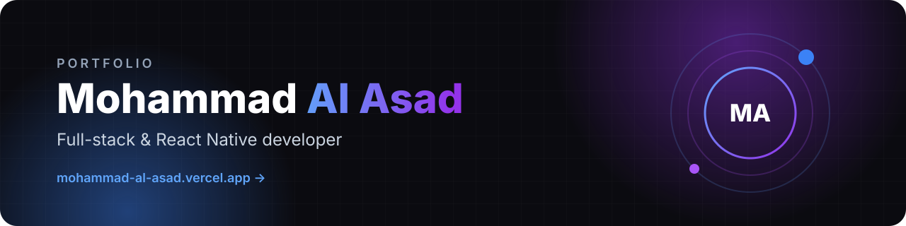
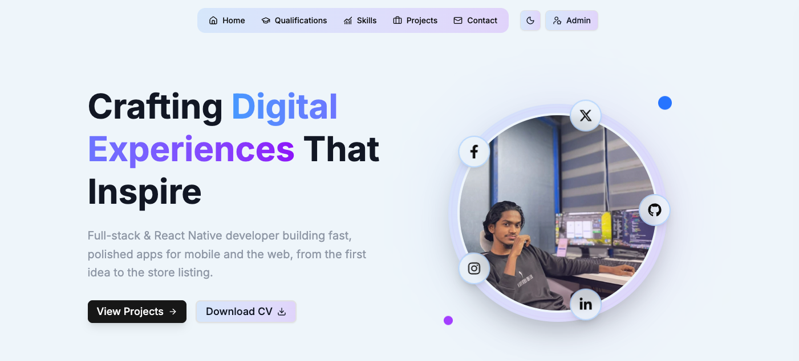
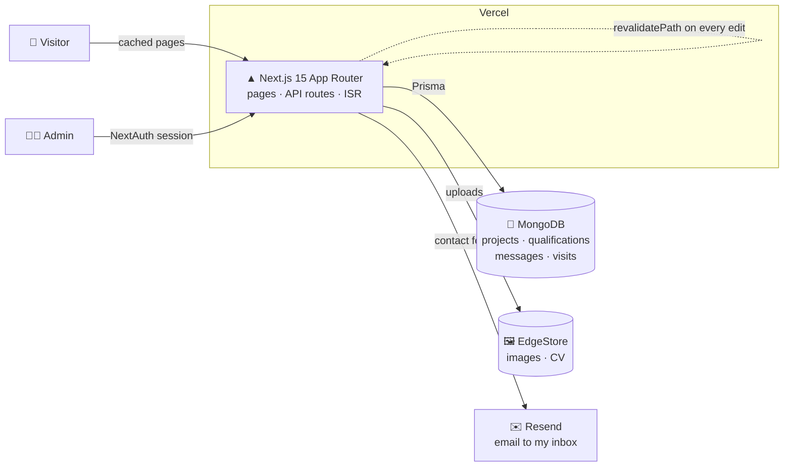
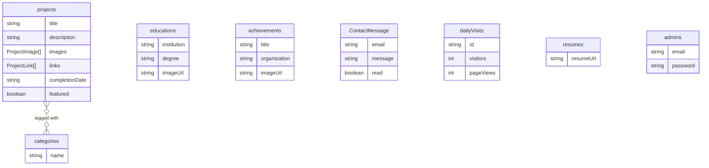

<div align="center">

<a href="https://mohammad-al-asad.vercel.app">
  
</a>


**My personal portfolio and the admin panel that runs it, so new work goes live in seconds without touching code.**


[](https://mohammad-al-asad.vercel.app)


<a href="https://mohammad-al-asad.vercel.app">
  <picture>
    <source media="(prefers-color-scheme: dark)" srcset="./.github/assets/home-dark.png" />
    <source media="(prefers-color-scheme: light)" srcset="./.github/assets/home-light.png" />
    
  </picture>
</a>

<sub>The screenshot follows your GitHub theme. Switch between light and dark to see both looks.</sub>


</div>


## 🧭 What's inside

<table>
<tr>
<td width="50%" valign="top">

### The public site
- **Hero** with my photo, social links in an orbit around it, and a one-click CV download
- **About** section with a short intro and what I'm working on, studying, and learning now
- **Qualifications:** education and achievements, each with its own page and certificate
- **Skills** with bars that fill as you scroll to them
- **Featured projects** on the home page, plus a full **projects page** you can filter by category and technology (filters stay in the URL, so a filtered view can be shared)
- **Project pages** with an image gallery, features, tech stack, and links to GitHub, the live site, the **App Store**, or **Google Play**
- **Contact form** that sends straight to my inbox
- **Light and dark themes**, responsive from phones to wide screens

</td>
<td width="50%" valign="top">

### The admin panel
- **Dashboard:** visitors, page views, a monthly chart, and the latest messages
- **Projects:** create, edit, and feature projects with multi-image uploads, always sorted by completion date
- **Qualifications:** education and achievements with certificate uploads
- **Messages:** an inbox with read and unread tracking
- **CV:** upload a new resume and the download button updates everywhere
- **Categories** managed right inside the project form
- Every change shows up on the public site **immediately**, with no redeploy

</td>
</tr>
</table>


## ⚡ Built to be fast

| | How |
| --- | --- |
| **Cached pages** | Public pages are pre-rendered and served from cache (`revalidate = 3600`), so visitors get static-site speed. |
| **Instant updates** | Every admin change calls `revalidatePath("/", "layout")`, so the cache refreshes the moment content changes instead of waiting an hour. |
| **On-demand detail pages** | Project and qualification pages render the first time someone opens them, then stay cached. |
| **Server components first** | Data is fetched on the server and passed down as props. Only interactive pieces (filters, forms, theme toggle) ship JavaScript. |
| **Light dependencies** | Animations are pure CSS. Framer Motion and other heavy libraries were removed. |
| **Optimised images** | `next/image` serves correctly sized, modern formats from EdgeStore's CDN. |


## 🔐 Built to be safe

- **Admin-only writes:** every create, update, and delete API, plus every file upload and delete in storage, checks for an admin session (NextAuth, JWT, bcrypt-hashed passwords).
- **Private messages:** only a signed-in admin can read contact messages. Anyone else sees a locked panel.
- **Spam-resistant contact form:** a hidden honeypot field, rate limits, length limits, email validation, and HTML escaping before anything is emailed.
- **Search engines stay out of private routes:** `robots.txt` blocks `/admin` and `/api`. The sitemap lists only public pages.
- **Privacy-friendly visitor stats:** one anonymous cookie, bots filtered out, and no third-party trackers.


## 🏗️ Architecture



### Data model




## 📂 Project structure

```text
The-Portfolio/
├── prisma/schema.prisma        # MongoDB models
├── public/                     # Hero photo
└── src/
    ├── app/
    │   ├── page.tsx            # Home: hero, stats, about, qualifications, skills, featured projects, contact
    │   ├── projects/           # Filterable project list + project pages
    │   ├── qualifications/     # All education and achievements
    │   ├── educations/[id]/    # Education detail page
    │   ├── achievements/[id]/  # Achievement detail page
    │   ├── admin/              # Dashboard, projects, qualifications, messages, login
    │   ├── api/                # REST routes: projects, educations, achievements, contact, resume, visit, stats
    │   ├── sitemap.ts · robots.ts · not-found.tsx · error.tsx
    │   └── layout.tsx          # Theme, nav, SEO metadata
    ├── components/             # UI sections, admin tables and forms, shadcn/ui primitives
    ├── lib/                    # Prisma client, EdgeStore, revalidation, sorting, analytics, validation
    ├── auth.ts                 # NextAuth credentials provider
    └── middleware.ts           # Sends signed-in admins past the login page
```


## 💻 Run it locally

**Prerequisites:** Node.js 20+, a MongoDB database (Atlas works), and free [EdgeStore](https://edgestore.dev) and [Resend](https://resend.com) accounts.

```bash
git clone https://github.com/mohammad-al-asad/The-Portfolio.git
cd The-Portfolio
npm install
npx prisma generate
```

Create a `.env` file:

```env
DATABASE_URL="mongodb+srv://<user>:<password>@<cluster>/<db>"

NEXTAUTH_URL="http://localhost:3000"
NEXTAUTH_SECRET="any-long-random-string"

EDGE_STORE_ACCESS_KEY="your-edgestore-access-key"
EDGE_STORE_SECRET_KEY="your-edgestore-secret-key"

RESEND_API_KEY="your-resend-api-key"
CONTACT_RECEIVER_EMAIL="where-contact-messages-should-go@example.com"
```

Start the dev server:

```bash
npm run dev
```

Open [http://localhost:3000](http://localhost:3000). The admin panel is at [/admin](http://localhost:3000/admin). To sign in, add a document to the `admins` collection with your email and a **bcrypt-hashed** password.

| Script | What it does |
| --- | --- |
| `npm run dev` | Dev server with Turbopack |
| `npm run build` | Production build |
| `npm run start` | Serve the production build |
| `npm run lint` | ESLint |


## ☁️ Deployment

Deployed on **Vercel**. Every push to `main` builds and goes live automatically, and pull requests get preview deployments. Content changes don't need a deploy at all, because they go through the admin panel and refresh the cache instantly.

---

<div align="center">

### Let's build something together

[](https://mohammad-al-asad.vercel.app)
[](https://github.com/mohammad-al-asad)
[](https://mohammad-al-asad.vercel.app/#contact)

<sub>Designed and built by <b>Mohammad Al Asad</b></sub>

</div>
